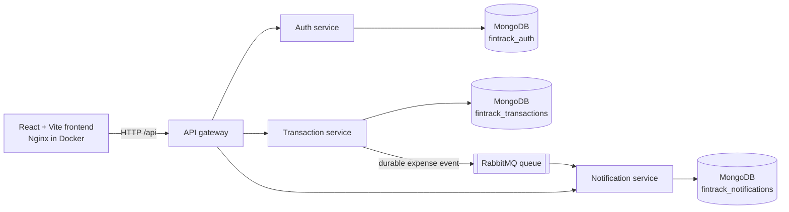

# FinTrack

FinTrack is a personal-finance tracker built as a MERN-style monorepo. The browser talks only to an API gateway; separate services own authentication, transactions, and notifications.

## Architecture



Services do not read another service's database. The gateway verifies access tokens, creates a request ID, and forwards the authenticated user ID to protected service routes.

## Services and ports

| Component | Port | Purpose |
| --- | ---: | --- |
| Frontend | `5173` on the host (`80` in its container) | Register/login, dashboard, transactions, and alerts |
| API gateway | `4000` | Public API, JWT verification, CORS, rate limiting, and proxying |
| Auth service | `4001` | Accounts, password hashing, access and refresh tokens |
| Transaction service | `4002` | User-scoped transaction CRUD, filters, and monthly summary |
| Notification service | `4003` | User expense thresholds and in-app notifications |
| MongoDB | `27017` internally | One MongoDB server with a separate database per service |
| RabbitMQ | `5672` internally | Durable expense-event queue |

Only the frontend and gateway ports are published to the host by default. MongoDB, RabbitMQ, and the individual services stay on the Compose network.

## Run locally

Requirements: Docker with the Compose plugin.

1. Copy the sample configuration and, for anything beyond local evaluation, replace the example secrets:

   ```sh
   cp .env.example .env
   ```

2. Start the stack and build the local images:

   ```sh
   docker compose up --build
   ```

   Compose starts MongoDB and RabbitMQ, waits for service health checks, and runs the one-shot seed job.

3. Open <http://localhost:5173>. The API gateway is at <http://localhost:4000>; check it with `curl http://localhost:4000/health`.

4. Sign in with the seeded demo account: `demo@fintrack.com` / `Demo@1234`. The seed adds transactions in two months, sets the alert threshold, and creates a sample expense above that threshold.

Useful commands:

```sh
docker compose ps
docker compose logs -f gateway transaction-service notification-service
docker compose run --rm seed
docker compose down
```

`docker compose down` preserves the named data volumes. To reset the local database and RabbitMQ data, use `docker compose down -v`; this deletes that local data.

## Environment variables

Compose reads variables from the root `.env` file. `.env.example` lists the complete local configuration. Never commit `.env` or use the sample secrets in production.

| Variables | Used for |
| --- | --- |
| `NODE_ENV`, `LOG_LEVEL` | Runtime mode and structured log verbosity |
| `PORT`, `AUTH_MONGODB_URI`, `JWT_ACCESS_SECRET`, `JWT_REFRESH_SECRET`, `ACCESS_TOKEN_TTL`, `REFRESH_TOKEN_TTL`, `BCRYPT_ROUNDS` | Auth service port, its database, access-token verification/signing secrets, token expiry, and password hashing |
| `TRANSACTION_PORT`, `TRANSACTION_MONGODB_URI` | Transaction service and its database |
| `NOTIFICATION_PORT`, `NOTIFICATION_MONGODB_URI`, `DEFAULT_EXPENSE_THRESHOLD` | Notification service, its database, and default alert amount in INR |
| `RABBITMQ_DEFAULT_USER`, `RABBITMQ_DEFAULT_PASS`, `RABBITMQ_URL`, `RABBITMQ_EXPENSE_QUEUE`, `RABBITMQ_CONNECT_TIMEOUT_MS`, `RABBITMQ_PUBLISH_TIMEOUT_MS`, `RABBITMQ_RECONNECT_DELAY_MS`, `RABBITMQ_RETRY_DELAY_MS` | Broker credentials, event queue, and connection/retry timing |
| `GATEWAY_PORT`, `AUTH_SERVICE_URL`, `TRANSACTION_SERVICE_URL`, `NOTIFICATION_SERVICE_URL`, `CORS_ORIGIN`, `RATE_LIMIT_WINDOW_MS`, `RATE_LIMIT_MAX` | Gateway port, internal service destinations, browser origin, and request rate limit |
| `FRONTEND_PORT`, `VITE_API_URL` | Published frontend port and gateway URL embedded at frontend build time; localhost is the browser's host |
| `SEED_API_URL`, `DEMO_EMAIL`, `DEMO_PASSWORD` | Gateway URL and credentials used by the one-shot sample-data script |

In deployed environments, provide secrets through the hosting platform rather than committing them to the repository.

## API

All application endpoints are exposed through the gateway. Protected endpoints require `Authorization: Bearer <access-token>`.

- `POST /api/auth/register`, `/login`, `/refresh`; `GET /api/auth/me`
- `GET|POST /api/transactions`; `PUT|DELETE /api/transactions/{id}`
- `GET /api/transactions/summary?month=YYYY-MM`
- `GET /api/notifications`; `PATCH /api/notifications/{id}/read`
- `PUT /api/notifications/settings/threshold`
- `GET /health`

The full request and response schemas are in [`swagger.yaml`](./swagger.yaml).

## RabbitMQ choice

Transaction creation and notification generation are separate responsibilities. A durable RabbitMQ queue with persistent expense messages lets the notification consumer process work asynchronously and recover queued messages after a restart; the producer does not need to call the notification database or wait for the notification service. If RabbitMQ is unavailable while an expense is being created, the transaction is still saved and the publish failure is logged. That keeps transaction entry available, but means an event can be missed during an outage; a production improvement would be a transactional outbox with monitored retries.

## CI and deployment

The GitHub Actions workflow in `.github/workflows/ci.yml` runs for pushes and pull requests targeting `main`. A five-entry matrix installs dependencies, runs lint and tests, builds the frontend bundle where applicable, and builds each service's Docker image. Pull requests build images but do not publish them.

On a push to `main`, the workflow authenticates to GHCR using `GITHUB_TOKEN` and publishes `latest` and commit-SHA tags for each image. Set the repository Actions variable `VITE_API_URL` to the public gateway URL so the built frontend image calls the deployed gateway; without it, the image uses the local default. After all matrix jobs pass, the workflow calls the optional `DEPLOY_HOOK_URL` repository Actions secret. If that secret is absent, the deploy-hook step reports that it is skipping and succeeds. Configure the variable and hook under the repository's **Settings → Secrets and variables → Actions**. The hook is responsible for making the hosting platform pull/redeploy the images.

## Trade-offs and future improvements

- For this assignment, one MongoDB server hosts three isolated databases. Separate database URLs and ownership boundaries keep service code independent, while a production deployment could use separately managed clusters and backups.
- Expense-event publishing is best-effort so a broker outage does not block saving a transaction. An outbox, retries, and dead-letter monitoring would provide stronger delivery guarantees.
- Refresh tokens are signed and expire, but are not stored/revoked server-side. A production version should support rotation, revocation, and safer browser storage.
- The Compose setup and demo credentials prioritize quick local evaluation. Production needs managed secrets, TLS, stronger observability, database migration/backup plans, and deployment-specific configuration.
- Free hosting plans may sleep when idle; allow roughly **30–60 seconds** for the first request while a service wakes up.

## AI Usage

GitHub Copilot and Claude were used for code generation. I reviewed and learned the code so I can explain the design and implementation.
